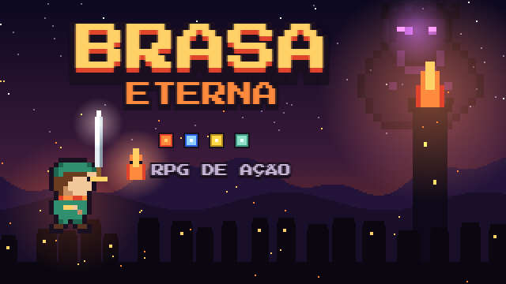

# Brasa Eterna

RPG de ação em pixel art no estilo Zelda clássico, feito em um único arquivo HTML/JavaScript.
Sem instalação e sem build: abra `index.html` no navegador e jogue.

**Jogar online:** https://hebersonmiliano.github.io/portal-jogos/jogo.html?id=brasa-eterna

## História

A Chama Sagrada se partiu em cinco brasas. Kael, um jovem de Brasalume que perdeu os pais
no ataque de Morvane, parte com a Faísca, o último fôlego da Chama, para recuperá-las e
descobrir de onde veio e que segredo guarda dentro de si.

## Capítulos

| Capítulo | Chefe | Desafio |
|---|---|---|
| 1. O Golem de Cinzas | Golem de Cinzas | Campina, ruínas e a chave da cripta |
| 2. A Rainha das Marés | Rainha das Marés | Pântano e templo inundado: acenda as velas para escoar a água |
| 3. O Caçador de Cinzas | Caçador de Cinzas | Floresta queimada, Bosque Perdido e emboscada em ondas |
| 4. O Guardião Traidor | Varek | Templo gelado com quatro provas elementais, em qualquer ordem |
| 5. A Última Brasa | Morvane | Volta a Brasalume, fuga pela torre e escolha entre dois finais |
| **Parte 2** — 6. O Deserto de Vidro | Colosso de Vidro | Espelhos de luz, dunas de vento, oásis com loja e pirâmide em descida |
| **Parte 2** — 7. Novos Horizontes | — | Mundo aberto com câmera, ciclo dia/noite, Vila Aurora (pousada, ferraria, mercearia, ancião), moradores, missões secundárias, mapa com névoa |

## Controles

| Ação | Teclado | Controle | Celular |
|---|---|---|---|
| Mover (8 direções) | WASD / setas | Analógico / direcional | Direcional na tela |
| Espada | J / Espaço / Z | A | A |
| Disparo elemental | segure e solte a espada | segure e solte A | segure e solte A |
| Esquiva | K / Shift / X | B | B |
| Equipamentos e joias | I / Enter | Start / Y | M |
| Trocar elemento (cap. 5) | Q | LB | E |
| Tela cheia | F | | |
| Som | M | Select | |

## Recursos

- 5 capítulos com mapas, caminhos e quebra-cabeças diferentes
- Elementos fogo, gelo, trovão e vento, com quebra-cabeças para cada um
- 14 equipamentos visíveis no personagem, com 3 níveis de melhoria e joias encaixáveis
- Faísca, a mascote, ataca sozinha e encontra passagens secretas
- Cavernas secretas, trilha sonora gerada no navegador e salvamento automático
- 24 conquistas com prêmios: gemas, joias e cachecóis novos para o Kael
- Três níveis de dificuldade e dois finais

## Créditos

- Ideia, história e direção: Heberson Miliano
- Programação, arte e música: Claude (Anthropic)
